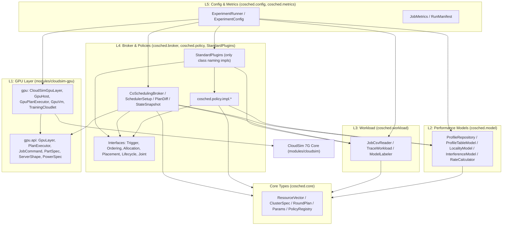
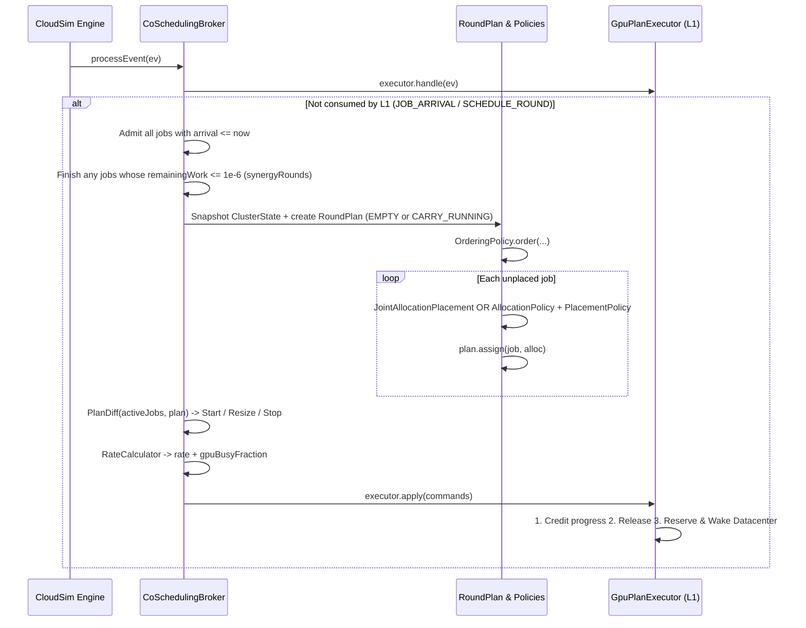

# System Architecture & Codebase Walkthrough

This document explains how the entire Java codebase is structured, why **CloudSim 7G** was chosen over CloudSim Plus, how the five layers communicate during a simulation, and what subtle CloudSim/Synergy behaviors shaped the design.

---

## 1. Repository & Maven Module Layout

The root [pom.xml](../pom.xml) targets **Java 21** and defines four Maven modules:

| Module | Path | Role | Depends On |
|---|---|---|---|
| `cloudsim` | `modules/cloudsim/` | Upstream **CloudSim 7G v7.0.1** discrete-event engine (kept **unmodified**) | — |
| `cloudsim-examples` | `modules/cloudsim-examples/` | Upstream CloudSim examples (kept **unmodified**) | `cloudsim` |
| `cloudsim-gpu` | `modules/cloudsim-gpu/` | **Layer 1 (L1):** `gpu.api` contract + `gpu` implementation on CloudSim 7G | `cloudsim` |
| `cloudsim-cosched` | `modules/cloudsim-cosched/` | **Core + Layers 2–5 (L2–L5):** models, workload, policies, broker, config, metrics | `cloudsim`, `cloudsim-gpu`, Jackson YAML, OpenCSV, ArchUnit (test) |

> **Why CloudSim 7G instead of CloudSim Plus?**
> During Phase 0 (`docs/archive/`), the team initially drafted plans around CloudSim Plus 8.5.7. Before implementation (Check 1 prototypes `prototypes/CheckA.java`–`CheckE.java`), the architecture was re-anchored on **CloudSim 7G (v7.0.1)** because CloudSim 7G already unified `HostEntity`/`GuestEntity`, exposed clean `PowerHost`/`PowerModel` hooks, and allowed keeping upstream `modules/cloudsim` completely untouched while building `cloudsim-gpu` and `cloudsim-cosched` cleanly beside it.

### Dependency Flow & ArchUnit Rules

Dependencies flow **strictly downward** (`L5 → L4 → L3/L2 → Core → gpu.api ← gpu`). The GPU module **never** depends on `cloudsim-cosched`.

Five **ArchUnit** tests in [ArchitectureTest.java](../modules/cloudsim-cosched/src/test/java/org/cloudbus/cloudsim/cosched/ArchitectureTest.java) run on every build and fail compilation/testing if anyone breaks module boundaries:
1. `cosched.policy..` may only depend on `cosched.core..`, `cosched.model..`, `cosched.policy..`, and `java..`. (Policies **never** touch the broker, metrics, or CloudSim directly.)
2. `cosched.core..` depends on **nothing** else in `cosched` or `gpu`.
3. `cosched.model..` does **not** depend on `cosched.policy..`, `cosched.broker..`, or `cosched.metrics..`.
4. No class in `cosched.policy.impl..` may depend on another class in `cosched.policy.impl..`. (Shared helpers live in `cosched.policy`: `Shares`, `Starvation`, `RemainingEstimate`.)
5. Only `StandardPlugins` (and tests) may reference `cosched.policy.impl..`.

---

## 2. Layer-by-Layer Breakdown

### Layer 1: GPU Layer (`modules/cloudsim-gpu`)

L1 models physical GPU servers and executes scheduling commands. **L1 never decides placement or throughput** — it only enforces capacity, executes commands, advances training work, and reports server status.

#### The Contract (`org.cloudbus.cloudsim.gpu.api`)
Why does `gpu.api` define its own small value types (`PartSpec`, `ServerShape`, `PowerSpec`, `ServerStatus`) instead of reusing `ResourceVector` from `cosched.core`? Because `cloudsim-cosched` depends on `cloudsim-gpu`; referencing `cosched.core` from `gpu.api` would create a **cyclic Maven dependency**.

- **`GpuLayer`**: `build(List<ServerShape>)`, `bind(SimEntity broker)`, `status(int serverIndex)`, `serverCount()`.
- **`PlanExecutor`**: `apply(List<JobCommand>)`, `remainingWork(int jobId)`, `handle(SimEvent)`, `setJobEndListener(JobEndListener)`.
- **`JobCommand`** (Java sealed interface with 3 records):
  - `Start(jobId, remainingWork, parts, rate, gpuBusyFraction)`
  - `Resize(jobId, parts, rate, gpuBusyFraction)` — same servers & GPU counts = **in-place resize**; different servers or GPU counts = **move** (stop + start with remaining work).
  - `Stop(jobId)` — preempts and retains remaining work in `stoppedRemaining`.

**Six Executor Contract Rules** (enforced by [PlanExecutorContractTest.java](../modules/cloudsim-gpu/src/test/java/org/cloudbus/cloudsim/gpu/contract/PlanExecutorContractTest.java)):
1. Before any resize or removal, credit every running job's progress at its old rate.
2. A resize is deallocate-then-reserve (never double-allocate host capacity).
3. After a resize, wake the CloudSim datacenter at the right time so finish events are recomputed.
4. Placement is **strictly** what the command says (`PlannedGuestAllocationPolicy`); a full host refuses rather than falling back to another host.
5. A refused creation or resize is a scheduler bug and throws immediately to stop the run.
6. The executor never terminates the simulation itself; the broker stops scheduling when done.

#### The CloudSim 7G Implementation (`org.cloudbus.cloudsim.gpu`)
- **`CloudSimGpuLayer`**: Builds a CloudSim `Datacenter` with one `GpuHost` per server and `PlannedGuestAllocationPolicy`.
- **`GpuHost`** (extends CloudSim's `PowerHost`):
  - Owns a **`GpuProvisioner`** that allocates whole `Gpu` objects exclusively (**gang allocation**, lowest-numbered GPUs first, all-or-nothing).
  - Tracks fractional CPU cores and memory in GB separately from CloudSim's nominal MIPS/RAM (each guest asks CloudSim for nominal `1` unit so CloudSim never throttles or rejects for integer rounding).
  - Maintains **synchronous reservations**: resources are reserved/released immediately inside `GpuPlanExecutor.apply()`, *before* CloudSim's asynchronous `VM_CREATE_ACK` / `VM_DESTROY` events run, preventing same-round capacity races.
  - Computes instantaneous server power:
    $$P = P_{\text{CPU}}(u_{\text{CPU}}) + \sum_{\text{GPUs}} P_{\text{GPU}}(u_{\text{GPU}}) + P_{\text{base}}$$
    using **`LinearPowerModel`** (which keeps idle servers powered on at `P_idle`, unlike CloudSim's `PowerModelLinear` which returns 0 W at 0 utilization) or CloudSim's built-in **SPECpower** tables.
- **`TrainingCloudlet` & `GpuCloudletScheduler`**: Tracks remaining work directly as a `double` in **iterations** (not integer CloudSim MI/MIPS). On every update at time $t$, it subtracts $\text{rate} \times (t - t_{\text{prev}})$ and predicts finish at $t + \text{remaining} / \text{rate}$. Completions within `1e-6 s` count as finished.
- **`TrainingJob`**: Groups all `GpuVm` + `TrainingCloudlet` parts of a multi-server job so they advance in **lock-step** at one rate and fire `JobEndListener` once when the last part finishes.
- **`GpuPlanExecutor`**: Executes `apply(commands)` in **three order-independent phases**:
  1. **Credit** all running jobs up to `now`.
  2. **Release** all `Stop`s, moved `Resize`s, and the old CPU/memory of all in-place `Resize`s.
  3. **Reserve** new CPU/memory for in-place `Resize`s, then reserve & start all `Start`s (including moved jobs), and schedule datacenter wake-ups at each changed job's predicted finish time.

---

### Core Types (`org.cloudbus.cloudsim.cosched.core`)

All core value types are **immutable Java records** with fail-fast validation:
- **`ResourceVector(int gpus, double cpus, double memGb)`**: Arithmetic (`plus`, `minus` → `Delta`), `fitsIn` with `EPS = 1e-9` tolerance, `cpusPerGpu()`.
- **`ServerGroup` & `Server`**: Models a homogeneous group in cluster YAML (`count`, `gpus`, `gpuType`, `cpus`, `memGb`, `storageMbps`, `netGbps`) and computes `proportionalShare(gpus)`. `ClusterSpec` expands groups into numbered `Server`s (`0..N-1`) and computes cluster-wide total `(G, C, M)`.
- **`Allocation`**: One `Allocation.Part(serverIndex, resources)` per server (no duplicate server indices). `samePlacement(other)` checks if servers and GPU counts match (telling the broker whether a change is an in-place resize or a move).
- **`Organisation`**: Optional teams with `gpuQuota` and priority classes (defaults to single `default` team).
- **`JobInfo` & `ClusterState`**: Read-only snapshots passed to policies so they cannot mutate simulator internals.
- **`RoundPlan`**: Draft allocations for one scheduling round. Enforces gang size and server capacity on every `assign(jobId, alloc)` call. Can start **`EMPTY`** (round-based preemption: any running job omitted is preempted) or **`CARRY_RUNNING`** (non-preemptive: running jobs keep their current allocations). Supports overwriting an existing entry in the same round—counting the job's previous allocation as free—which is how `SynergyTune` shrinks peers.
- **`Params` & `PolicyRegistry`**: Every plugin parameter must be read through `Params.getDouble` / `getChoice` / `getBoolean` / `getDoubleList` with an explicit **default** and **valid range**. Unknown plugin names, out-of-range values, and unread keys (typos) fail fast before the simulation starts.

---

### Layer 2: Performance Models (`org.cloudbus.cloudsim.cosched.model`)

- **`Profile` & `ProfileRepository`**: Loads converted JSON profiles (`<model>_<gpus>.json`). Supports two GPU-count lookup modes:
  - `linear` (Synergy default): uses `<model>_1` for any GPU count.
  - `per_gpu_count`: looks up exact `<model>_<gpus>`.
  Checks `requireAll(...)` before the run starts; missing profiles fail fast (no fallback across GPU types). Handles trailing all-zero rows in multi-GPU profiles as "unmeasured".
- **`ProfileTableModel`** (`ThroughputModel`): Computes speedup relative to the server's **fixed share** $(c_{\text{fair}}, m_{\text{fair}}) = (\text{server CPUs}/\text{GPUs}, \text{server mem}/\text{GPUs})$:
  $$\text{speedup}(c, m) = \frac{T(c, m)}{T(c_{\text{fair}}, m_{\text{fair}})}$$
  - **`table` mode**: Linearly interpolates between CPU points (`1, 2, 3, 4, 5, 6, 9, 12, 24`) and picks the largest measured memory column $\le m$ (`20.83, 62.5, 125, 187.5, 250` GB). Never extrapolates past the last measured CPU point (clamps and logs one warning per model). Normalizing by $T(c_{\text{fair}}, m_{\text{fair}})$ automatically reproduces Synergy's Fig. 12 clusters (`models-4/5/6` on 32/40/48-CPU servers).
  - **`synergy_two_point` mode**: Exact Synergy rule — returns `idealSpeedup` if the job holds at least `idealDemand(job, group)`, else `1.0`.
  - **`idealDemand(job, group)`**: Scales 1-GPU ideal `(cpus, mem)` by `job.gpus()`, capped at one server's capacity with speedup linearly re-interpolated by cores (if `job.gpus() > group.gpus()`, falls back to fixed share with speedup `1.0`).
- **`LocalityModel`**: Returns `1.0` for single-server allocations, or `localityPenalty` when spread across multiple servers.
- **`InterferenceModel`**: Named seam for neighboring-job slowdown; currently `InterferenceModel.NONE` (`1.0`).
- **`RateCalculator`**: Single source of truth for execution speed:
  $$\text{rate} = \frac{\text{speedup} \times \text{locality} \times \text{interference}}{\text{iter\_time\_s}} \quad (\text{iterations/s})$$
  Also computes `gpuBusyFraction` $= \min(1, \text{speedup} / \text{idealSpeedup})$ for GPU power modeling.

---

### Layer 3: Workload (`org.cloudbus.cloudsim.cosched.workload`)

- **`JobCsvReader`**: Parses job CSVs (supports both `iterations` + optional `iter_time_s`, and `duration_s` trace jobs; ignores extra columns like `jct_s`; reports line-numbered errors; rejects duplicate IDs).
- **`TraceWorkload`**: Sorts jobs by `(arrivalS, jobId)` and applies the configured **`ModelLabeler`**:
  - **`from_trace`**: Reads the CSV's `model` column directly.
  - **`class_split`**: Reproduces Synergy's `OVERALL` assignment (`jobs/workload.py`). Computes class priority $\frac{\text{target\%}}{100} - \frac{\text{class count so far}}{\text{total so far}}$, assigns the job to the highest-priority class (ties to earlier class: `image` → `language` → `speech`), and picks models round-robin inside that class. Because `OVERALL` depends only on arrival order, it reproduces all 1,000 measured Synergy labels identically.

---

### Layer 4: Policies & Broker (`cosched.policy`, `cosched.broker`, `StandardPlugins`)

All concrete plugins are registered exclusively in [StandardPlugins.java](../modules/cloudsim-cosched/src/main/java/org/cloudbus/cloudsim/cosched/StandardPlugins.java):

| Plug Point | Registered Names & Parameters | Behavior |
|---|---|---|
| `SchedulingTrigger` | `periodic` (`round_s`: 300, `[1, 86400]`) `event_driven` | When rounds fire (`periodic` vs on every arrival & job end). |
| `OrderingPolicy` | `fifo` `srtf` (`estimate`: `fixed_share` \| `current_or_ideal`) `las` (`largest_first`: `false`) `ftf` (`estimate`: `fixed_share` \| `current_or_ideal`) | Order jobs are considered. `srtf`, `las`, `ftf` put jobs unscheduled for $> 1000\text{ h}$ first (`Starvation`). `las` with `largest_first: true` matches Synergy's `LAS+tune` multi-GPU sort. |
| `AllocationPolicy` | `gpu_proportional` `synergy_greedy` | `gpu_proportional` = fixed share (`+fair`). `synergy_greedy` = `idealDemand` (skipped if it doesn't fit). |
| `JointAllocationPlacement` | `synergy_tune` | Places at ideal demand → drops to fixed share if above fair → shrinks co-located peers on underutilized servers (fewest parts, then highest CPUs/GPU, then highest mem/GPU) back to fixed share. |
| `PlacementPolicy` | `consolidated` (`locality`: `strict` \| `soft`) `first_fit` (`locality`: `soft` \| `strict`) | `consolidated` picks fullest fitting server (`STRICT` = single server; `SOFT` = Synergy `SYNERGY_PLACEMENT`). `first_fit` scans servers by index (`SOFT` default = Synergy `SYNERGY_RANDOM`). Multi-server parts always receive proportional shares (`Shares`). |
| `LifecycleController` | `non_preemptive` `round_based` (`synergy_rounds`: `false`) | `non_preemptive` uses `CARRY_RUNNING`. `round_based` uses `EMPTY` (free preemption each round). `synergy_rounds: true` quantizes round progress to $\lfloor \text{round\_s} / t_{\text{iter}} \rfloor$ and rounds finish times up to round boundaries. |
| `ModelLabeler` | `from_trace` `class_split` (`split`: `[34, 33, 33]`) | Labels jobs from CSV or via Synergy's class-split rule. |

#### How `CoSchedulingBroker` Runs a Round

`CoSchedulingBroker` extends `SimEntity` (not `DatacenterBroker`, so `GpuPlanExecutor` handles all VM/cloudlet acks cleanly):

---

### Layer 5: Config, Runner & Metrics (`cosched.config`, `cosched.metrics`)

- **`ExperimentConfig`**: Parses experiment YAML via Jackson, rejects unknown keys, resolves relative paths relative to the YAML file.
- **`ExperimentRunner`**: Iterates `candidates × seeds`. For each run: instantiates plugins via `StandardPlugins`, loads & labels `TraceWorkload`, validates `profiles.requireAll(...)`, builds `CloudSimGpuLayer`, runs `CloudSim.startSimulation()`, asserts zero unfinished jobs, and writes:
  - `jobs.csv`: `job_id,model,gpus,arrival_s,start_s,finish_s,jct_s,queue_s,starts,cpus_per_gpu,mem_gb_per_gpu`
  - `manifest.json`: Git commit (`+dirty` if uncommitted changes), SHA-256 of YAML & CSV, model settings, all resolved plugin parameters (defaults included), cluster spec, assumptions, warnings, rounds, commands, summary (`mean_jct_h`, `p99_jct_h`, `p99.9_jct_h`, `mean_queue_s`, `makespan_s`), and wall time.

---

## 3. Six Critical Bugs Discovered & Fixed

Understanding these six issues explains *why* several parts of the code look the way they do:

1. **0.01 s Start Delay on `VM_CREATE_ACK` (Phase 1a):** CloudSim's `Datacenter` delays `VM_CREATE_ACK` by `minTimeBetweenEvents` (`0.01 s`). Waiting for the ack before submitting a cloudlet delayed every job start by `0.01 s`. **Fix:** Submit `TrainingCloudlet` immediately in the same instant behind `VM_CREATE`; use the ack only to catch errors.
2. **Grow-Before-Shrink Deadlock in One Round (Phase 1b):** Releasing and re-reserving each in-place resize one by one fails if job B grows from 6→18 cores before job A shrinks from 18→6 on a 24-core server. **Fix:** `GpuPlanExecutor.apply()` runs in 3 phases (credit → release all → reserve all).
3. **Dropped Datacenter Wake-Up Within `0.01 s` (Phase 1b):** `Datacenter.updateCloudletProcessing()` silently ignores updates requested within `0.01 s` of its previous update—meaning a job sped up at the exact instant another job ended kept its old slow predicted finish time (e.g., `1000 s` instead of `190 s`). **Fix:** Schedule a datacenter update at each changed job's **new predicted finish time**. *(Remaining limit: CloudSim's `0.02 s` minimum gap between updates means two finishes `< 0.02 s` apart can see the second delayed by up to `0.02 s`.)*
4. **Arrivals Exactly on a Round Boundary (Phase 4):** Synergy processes equal-time events as `arrival → job end → lease end → schedule`. CloudSim queued our round event before the arrival event, delaying boundary arrivals by `300 s`. **Fix:** At the start of each round, the broker admits all arrivals with `arrival_s <= now` (and skips duplicate arrival events later).
5. **Missing Starvation Boost on `FTF` (Phase 4):** `FTF` shares Synergy's 1000-hour starvation boost with `SRTF` and `LAS`, which was initially missed in Phase 3. **Fix:** `FtfOrdering` uses `Starvation.isStarved(...)`, bringing FTF+Tune from 650/1000 to 1000/1000 exact matches.
6. **`LAS+Tune` Largest-GPU-First Placement (Phase 4):** In multi-GPU runs (`las_synergy_new.py`), Synergy picks runnable jobs in LAS order up to free GPUs, then sorts those chosen jobs by `-gpu_deficit` before placing. **Fix:** Added opt-in `largest_first` flag on `LasOrdering`, matching all 26,062 rounds identically.
