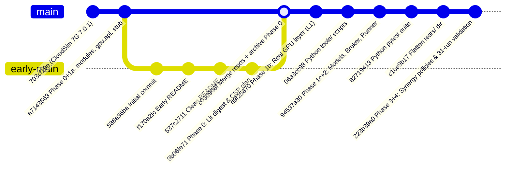

# Commit-by-Commit History & Project Evolution

This document walks through **every commit made by the team** on top of upstream CloudSim 7G (`703cf19e`), explaining *what changed*, *why it changed*, and *what we learned* at each step.

---

## Timeline Overview

The repository contains two merged histories that joined in commit `c036968f`:
1. **Track A (`Hamiz` / `hMiZ-STD`):** Repository setup, Phase 0 literature survey & early CloudSim Plus design (`588e36ba` → `9b06fe71`), Python validation tools (`06a3cc98`), and Python `pytest` suite (`82719413` → `c1ce9b17`).
2. **Track B (`Chirag1216`):** CloudSim 7G architecture, Check 1 prototypes, core types & `gpu.api` (`a7143563`), real L1 GPU layer (`d9f25870`), Phases 1c & 2 vertical slice (`94537a30`), and Phases 3 & 4 Synergy policies & 31-config validation (`223b39a0`).

---

## Detailed Commit Log

### 1. `588e36ba` — Initial commit
- **Author:** Hamiz (`177643824+hMiZ-STD`) · **Date:** 2026-08-25
- **Changes:** Added `README.md` (1 line).
- **Significance:** Created the original team repository root before Phase 0 research began.

---

### 2. `f170a2fc` — `update README.md`
- **Author:** Hamiz · **Date:** 2026-08-25
- **Changes:** Expanded `README.md` (+16/-1 lines) with the initial project framing ("Hybrid CPU-GPU Resource Scheduling and Utilization Analysis for AI Workloads").
- **Significance:** Established the core problem statement: co-scheduling CPU and GPU resources together for AI workloads to avoid fragmentation and idle hardware.

---

### 3. `537c2711` — `Update README.md`
- **Author:** Hamiz · **Date:** 2026-10-08
- **Changes:** Trimmed 8 lines from `README.md` ahead of structured Phase 0 planning.

---

### 4. `9b06fe71` — `phase : 0`
- **Author:** `hMiZ-STD` · **Date:** 2026-10-08
- **Files added (10 files, +1,394 lines + 2 PDFs):**
  - `AGENTS.md`, `PROJECT_MEMORY.md`, `Plan.md`, `docs/Plan.md`, `docs/DRAFT_PLAN_FROM_CHAT.md`
  - `docs/phase0/LITERATURE_DIGEST.md` (571 lines) — Plain-language and technical summaries of key scheduling papers: CloudSim Plus, GPUCloudSim, DRF (NSDI '11), Tetris (SIGCOMM '14), Tiresias (NSDI '19), Gandiva (OSDI '18), Philly trace (ATC '19), Horus (TPDS '22), FGD (ATC '23), Alibaba cluster trace, Firmament, and Optimus.
  - `docs/phase0/PROPOSED_PLAN.md` (523 lines) — Initial design proposal for **FRADS** (*Fragmentation-and-Resource-Aware Dynamic Scheduler*) targeting CloudSim Plus 8.5.7.
  - `docs/papers/paper_2.pdf`, `docs/papers/paper_3.pdf` — Reference papers kept for the team.
- **Why this matters:** Built the shared literature foundation and explicitly verified why `GPUCloudSim` (targeting CloudSim 3) could not be imported directly. *(Later superseded when the team adopted CloudSim 7G and Synergy OSDI '22 validation as the primary baseline; preserved under `docs/archive/`.)*

---

### 5. `a7143563` — `Add co-scheduling and GPU-layer modules: core types, gpu.api contract, stub GPU layer`
- **Author:** `Chirag1216` · **Date:** 2026-11-21 · **Report:** [phase-0-1a-foundations.tex](../reports/phase-0-1a-foundations.tex)
- **Changes (41 files, +2,720 lines, built on CloudSim 7G `703cf19e`):**
  - **Root & Maven setup (`pom.xml`, `modules/cloudsim-gpu/pom.xml`, `modules/cloudsim-cosched/pom.xml`):** Added two new modules alongside untouched `cloudsim` and `cloudsim-examples`, plus Jackson YAML (`2.17.2`), ArchUnit (`1.3.0`), and Surefire (`3.2.5`) on Java 21.
  - **Check 1 prototypes (`CheckA.java`–`CheckE.java`, originally in `modules/`):** Five standalone CloudSim 7G experiments proving VM creation/destruction at 100k scale, dynamic VM resizing, exact finish times across 2,000 jobs / 6,876 resizes, strict placement, and lock-step spread jobs.
  - **Core value types (`cosched.core`):** `ResourceVector`, `ServerGroup`, `Server`, `ClusterSpec`, `Allocation`, `Organisation`, `JobInfo`, `ClusterState`, `RoundPlan` (capacity-checked & revisable per round), `PolicyRegistry`, `Params` (default + range + unused-key checks).
  - **GPU-layer contract (`gpu.api`):** `GpuLayer`, `PlanExecutor` (with the 6 executor rules), `JobCommand` (`Start` / `Resize` / `Stop`), `PartSpec`, `ServerShape`, `JobEndListener`. Separate from `cosched.core` to avoid a cyclic Maven dependency.
  - **Stub GPU layer (`gpu.stub`):** `StubGpuLayer`, `StubGpuHost`, `StubPlanExecutor`, `PlannedGuestAllocationPolicy`, plus 8 stub tests (`StubPlanExecutorTest`) and 12 core tests (`CoreTypesTest`), bringing the project to **201 passing tests**.
- **Key bug discovered:** CloudSim's `Datacenter` delays `VM_CREATE_ACK` by `minTimeBetweenEvents` (`0.01 s`). Submitting cloudlets only after receiving the ack made every job start `0.01 s` late. Fixing the stub to submit the cloudlet immediately behind the create request resolved it.

---

### 6. `c036968f` — `Merge team repo; archive earlier CloudSim Plus planning docs`
- **Author:** `Chirag1216` · **Date:** 2026-11-21
- **Changes (12 files):**
  - Merged `9b06fe71` (`hMiZ-STD`) into `a7143563` (`Chirag1216`).
  - Moved the early CloudSim Plus planning docs (`AGENTS.md`, `PROJECT_MEMORY.md`, `Plan.md`, `DRAFT_PLAN_FROM_CHAT.md`, `phase0/*`, `papers/*`) into `docs/archive/` with an explanatory `docs/archive/README.md`.
  - Split the root `README.md` (focused on the co-scheduling project) from `README-CloudSim.md` (upstream CloudSim 7G readme).

---

### 7. `d9f25870` — `Add the GPU layer (L1) on CloudSim 7G and retire the stub`
- **Author:** `Chirag1216` · **Date:** 2026-11-21 · **Report:** [phase-1b-gpu-layer.tex](../reports/phase-1b-gpu-layer.tex)
- **Changes (25 files, +1,480 / -409 lines):**
  - **Replaced `gpu.stub` with real `org.cloudbus.cloudsim.gpu`:**
    - `CloudSimGpuLayer`, `GpuHost` (`PowerHost` with synchronous reservations and CPU+GPU+base power), `Gpu` (exclusive + NUMA `socket` hook), `GpuProvisioner` (gang allocation, lowest-index first), `GpuVm`, `TrainingCloudlet`, `GpuCloudletScheduler`, `TrainingJob` (lock-step parts), `GpuPlanExecutor` (3-phase `apply()`: credit → release → reserve), `LinearPowerModel`, and `PlannedGuestAllocationPolicy`.
  - **Extended `gpu.api`:** Added `gpuBusyFraction` to `Start`/`Resize`, optional `PowerSpec` on `ServerShape`, and `ServerStatus` / `GpuLayer.status(i)`.
  - **Tests:** Converted stub tests into abstract `PlanExecutorContractTest` (9 contract tests) + 7 new `CloudSimGpuLayerTest` tests (**209 tests passing**). Across 300 randomly resized jobs, worst finish-time error dropped from `0.037 s` (Check 1) to **`0.000000 s`**.
- **Two major CloudSim bugs fixed:**
  1. *Grow-before-shrink capacity bug:* Splitting `GpuHost` resize into `releaseCoresAndMemory` and `reserveCoresAndMemory` across phases 2 and 3 of `apply()`.
  2. *Dropped wake-up bug:* CloudSim's `Datacenter.updateCloudletProcessing()` drops updates within `0.01 s` of its last run—causing a 10× sped-up job at another job's completion to finish at `1000 s` instead of `190 s`. Fixed by scheduling a datacenter update at each changed job's new predicted finish time.

---

### 8. `06a3cc98` — `Add tools/ folder: Synergy profile converter, job extractor, Philly prep, run comparator`
- **Author:** `hMiZ-STD` · **Date:** 2026-11-21
- **Files added (6 files, +1,119 lines):**
  - `tools/convert_synergy_profiles.py` (349 lines): AST-parses Synergy's `models*/*.py` files (without importing Synergy) into our Profile JSON format and verifies fair-share cells.
  - `tools/extract_synergy_jobs.py` (275 lines): Extracts jobs `4000–4999` from Synergy `out.log` (and `--jct-csv` / `--cache-pickle`) into Job CSV.
  - `tools/prep_philly.py` (186 lines): Filters Microsoft Philly's `cluster_job_log` (Pass status, valid timestamps, `>0` GPUs/duration, optional `--strict` `<=8` GPUs) into Job CSV + filter summary + ID map.
  - `tools/compare_runs.py` (152 lines): Compares simulated JCTs against a reference CSV (`mean`, `p99`, `p99.9`, within-1s share, max diff, `PASS`/`FAIL` at `<=10%` relative error).
  - `tools/requirements.txt` and `tools/README.md` (154 lines).

---

### 9. `94537a30` — `finished phase 1c and 2`
- **Author:** `Chirag1216` · **Date:** 2026-11-22 · **Reports:** [phase-1c-formats-models-workload.tex](../reports/phase-1c-formats-models-workload.tex) & [phase-2-vertical-slice.tex](../reports/phase-2-vertical-slice.tex)
- **Changes (69 files, +3,130 / -7 Java/doc lines + converted profiles & presets):**
  - **Repository housekeeping:** Moved CloudSim's docs/UMLs into `docs/cloudsim/`, moved `CheckA`–`CheckE` into `prototypes/` with `prototypes/README.md`, and added `docs/formats.md`.
  - **Presets & Profiles:** Checked in 69 converted Synergy V100 profiles (`presets/profiles/synergy-v100/` across `models`, `models-4`, `models-5`, `models-6`), Synergy's FIFO+Tune reference CSV (`presets/reference/synergy_ref_fifo_tune_9jph.csv`), and the 20-job `presets/smoke/` preset.
  - **Layer 2 (`cosched.model`):** `Profile`, `ProfileRepository`, `ProfileTableModel`, `LocalityModel`, `InterferenceModel`, `RateCalculator`. Discovered that Synergy's `models-4/5/6` normalize `ideal_speedup` against each cluster's own fixed share (`4/5/6` cores/GPU) and fixed `ProfileTableModel` accordingly.
  - **Layer 3 (`cosched.workload`):** `JobRecord`, `JobCsvReader`, `TraceWorkload`, `ModelLabeler`, `FromTraceLabeler`, `ClassSplitLabeler` (`OVERALL` mode, reproducing all 1,000 Synergy model labels deterministically).
  - **Layer 4 (`cosched.policy`, `cosched.broker`, `StandardPlugins`):** All 5 policy interfaces, initial implementations (`fifo`, `gpu_proportional`, `consolidated` STRICT, `non_preemptive`, `periodic` & `event_driven` triggers), `CoSchedulingBroker` (extending `SimEntity`), `PlanDiff`, `SchedulerSetup`, `StateSnapshot`.
  - **Layer 5 (`cosched.config`, `cosched.metrics`):** `ExperimentConfig`, `ExperimentRunner`, `JobMetrics`, `RunManifest`.
  - **Tests:** `ArchitectureTest` (5 ArchUnit rules), `ProfileModelTest`, `WorkloadTest`, `ExperimentConfigTest`, `BrokerTest`, `ExperimentRunnerTest` — bringing total tests to **242 passing**.

---

### 10. `82719413` — `Add test suite for Synergy profile conversion and job extraction`
- **Author:** `hMiZ-STD` · **Date:** 2026-11-23
- **Changes (6 files, +514 lines):**
  - Added Python `pytest` suite (`conftest.py`, `data/philly_sample.json`, `test_compare_runs.py`, `test_convert_synergy_profiles.py`, `test_extract_synergy_jobs.py`, `test_prep_philly.py`) covering synthetic unit cases plus optional live Synergy checks (skipped when `SYNERGY_REPO` / logs aren't present).

---

### 11. `c1ce9b17` — `test suite`
- **Author:** `hMiZ-STD` · **Date:** 2026-11-23
- **Changes (6 renames):** Flattened accidental `tests/tests/*` nesting into `tests/*`.

---

### 12. `223b39a0` — `Phases 3 and 4: Synergy's policies and validation against Synergy's simulator`
- **Author:** `Chirag1216` · **Date:** 2026-11-25 · **Reports:** [phase-3-synergy-policies.tex](../reports/phase-3-synergy-policies.tex) & [phase-4-validation.tex](../reports/phase-4-validation.tex)
- **Changes (136 files total; +2,516 / -55 code/doc lines + 30 validation presets):**
  - **Validation plan (`docs/validation-plan.md`):** Documented exact differences between the OSDI '22 paper and Synergy's actual Python code (`1bb2bed`).
  - **Phase 3 policies (`cosched.policy` & `impl`):**
    - `JointAllocationPlacement` + `SynergyTune` (`synergy_tune`)
    - `SynergyGreedyAllocation` (`synergy_greedy`)
    - `FirstFitPlacement` (`first_fit`, Synergy's `SYNERGY_RANDOM`) and `SOFT` locality in `ConsolidatedPlacement` (`SYNERGY_PLACEMENT`), plus shared `Shares` helper
    - `RoundBasedLifecycle` (`round_based` with `synergy_rounds`)
    - `SrtfOrdering`, `LasOrdering`, `FtfOrdering` + `Starvation` (1000-hour boost) + `RemainingEstimate` (`fixed_share` vs `current_or_ideal`)
    - `ProfileTableModel` extended with Synergy's server-capped `idealDemand` and `synergy_two_point` mode
  - **Phase 4 validation infrastructure & results:**
    - Added `tools/synergy_record_to_jobs.py` and `tools/synergy_validation/` (`queue.txt`, `run_synergy.sh`, `build_suite.py`, `README.md`).
    - Added `presets/synergy-replica/` (with `synergy_ref_fifo_fair_9jph.csv` and `synergy-replica.yaml`) and `presets/synergy-validation/` (30 configurations + `manifest.csv`).
    - Added `SynergyPoliciesTest`, `SynergyRoundsTest`, `SynergyValidationTest` (runs on every build), and `SynergyValidationSuiteTest` (opt-in for all 30 configs).
    - **Three validation bugs caught and fixed:** arrivals on round boundaries, FTF's 1000-hour starvation boost, and LAS+Tune's `largest_first` placement order.
    - **Final result:** **1,000/1,000 measured jobs exact to the second (`0.0 s` max diff)** across all **31 configurations**.
